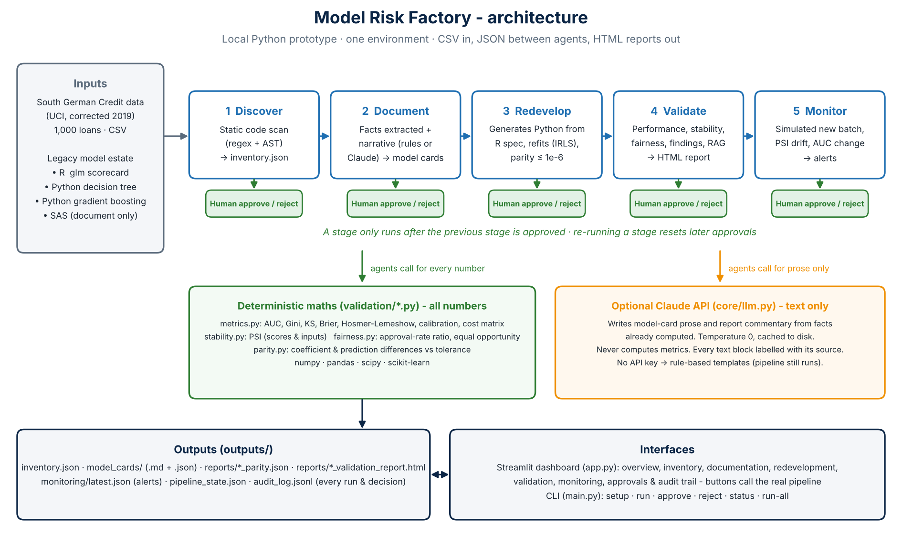

# Model Risk Factory · EXL × Trinity Data & AI Hackathon 2026 · Challenge 04

An AI-assisted "factory" that **discovers, documents, redevelops, validates and monitors** a bank's model inventory, with a human approval gate between every stage.

The client is a fictional Tier-1 UK retail bank. All data is public: the corrected *South German Credit* dataset.



## What it does

| Stage | Agent | What happens | Output |
|---|---|---|---|
| 1 | **Discover** | Scans `legacy_models/` (R, Python, SAS) without running the code. Finds model ID, owner, language, methodology, target, inputs, documentation age and risk tier | `outputs/inventory.json` |
| 2 | **Document** | Writes a draft model card for each model. Facts are extracted from the code; the narrative (purpose, assumptions, limitations, risks) comes from rules, or from Claude if an API key is set | `outputs/model_cards/*.md` / `.json` |
| 3 | **Redevelop** | Runs the legacy **R** scorecard, **generates a Python module** from its specification, refits it independently and proves parity on every coefficient and every prediction | `redeveloped_models/`, `outputs/reports/CR-PD-001_parity.json` |
| 4 | **Validate** | Performance (AUC, Gini, KS, Brier, Hosmer-Lemeshow, calibration, cost), stability (PSI), fairness (approval-rate ratio, equal opportunity), rule-based findings and a RAG rating | `outputs/reports/*_validation_report.html` |
| 5 | **Monitor** | Scores a simulated production batch (`stable` or `drift`), measures input and score drift (PSI) and the change in AUC, and raises alerts that trigger re-validation | `outputs/monitoring/latest.json` |

**Design rules**
- **AI never produces a number.** Every metric is calculated by plain Python in `validation/`. Claude, when enabled, only writes prose from numbers it is given, and every text block is labelled with its source (`extracted`, `rule_based` or `ai_generated`).
- **Humans approve every stage.** A stage cannot run until the previous stage is approved. Re-running a stage resets every later approval. Every run and every decision is written to `outputs/audit_log.jsonl`.
- **Runs without a Claude API key.** Without a key, rule-based templates write the text and the whole pipeline still works.

## Headline results (hold-out test set, 300 loans)

| Model | Language | AUC | Gini | Score PSI | Rating | Key findings |
|---|---|---|---|---|---|---|
| CR-PD-001 Application scorecard | R → Python | 0.757 | 0.515 | 0.052 | AMBER | Uses age directly; under-25 approval-rate ratio 0.55 |
| CR-EW-002 Early-warning tree | Python | 0.706 | 0.411 | 0.072 | AMBER | Poor calibration (mean PD 1.56× observed) |
| CR-PR-003 Pricing GBM | Python | 0.791 | 0.582 | 0.051 | AMBER | Overfitting (train AUC 0.965 vs 0.791) |
| CR-BH-004 Behavioural score | SAS | - | - | - | Not validated | Documentation only; cannot be run without SAS |

**R→Python parity:** the largest difference is 1.2e-15 on predictions and 4.7e-15 on coefficients, against a tolerance of 1e-6. All 300 test and 700 training records were compared.

**Monitoring (drift scenario, severity 0.6):** 20 alerts. All 3 executable models were flagged for re-validation.

---

## Setup on a Mac (step by step)

**Shortcut:** in Finder, double-click **`setup_mac.command`** once (it creates the environment, installs everything, builds the models and runs the tests; output is saved to `setup_log.txt`). After that, double-click **`start_dashboard.command`** whenever you want the dashboard. If macOS blocks it the first time, right-click the file → **Open** → **Open**. The manual steps below do the same thing.

You need **Python 3.11 or newer**. R is optional: without it, the Redevelop agent uses the recorded outputs of a genuine R run, which are committed in `legacy_models/artifacts/`.

1. **Check Python.** Open VS Code, then *Terminal → New Terminal*, and type:
   ```bash
   python3 --version
   ```
   If the version is below 3.11, or the command isn't found, install Python from <https://www.python.org/downloads/macos/> and open a new terminal.

2. **Get the code.**
   ```bash
   git clone https://github.com/ackriel/Ch4-model-risk-factory.git
   cd Ch4-model-risk-factory
   code .            # opens the folder in VS Code (optional)
   ```

3. **Create a virtual environment and install the packages** (about 2 minutes):
   ```bash
   python3 -m venv .venv
   source .venv/bin/activate        # your prompt now starts with (.venv)
   pip install -r requirements.txt
   ```

4. **(Optional) Install R** to run the legacy scorecard live: `brew install r`, or the installer from <https://cran.r-project.org/bin/macosx/>.

5. **Build the legacy model estate** (retrains the Python models for your scikit-learn version, and runs R if installed):
   ```bash
   python main.py setup
   ```

6. **Run the tests:**
   ```bash
   pytest -q            # expect: 11 passed
   ```

7. **Start the dashboard:**
   ```bash
   streamlit run app.py
   ```
   Your browser opens at http://localhost:8501. Type your name in the sidebar, then work through the pages in order. On each page: **Run**, check the output, then **Approve** (or **Reject**).

### Optional: Claude-written narrative
```bash
export ANTHROPIC_API_KEY="sk-ant-..."      # from console.anthropic.com
export CLAUDE_MODEL="claude-sonnet-5-5"    # optional
```
Re-run *Document* and *Validate*. The model cards and commentary are then labelled `ai_generated (...)`. Responses are cached in `outputs/llm_cache/`, so later runs give the same text.

### Command-line alternative
```bash
python main.py status
python main.py run discover
python main.py approve discover --reviewer "Your Name" --comment "Inventory complete"
python main.py run document          # blocked until discover is approved
python main.py run monitor --scenario drift --severity 0.8
python main.py run-all --reviewer "CI" --auto-approve   # testing only; logged as automated
```

## Project structure

```
app.py                  Streamlit dashboard (7 pages; buttons drive the pipeline)
main.py                 Command line
core/                   config, data loading, pipeline + approval gates, audit log, scoring, optional Claude client, impact estimate
agents/                 discover.py · document.py · redevelop.py · validate.py · monitor.py
validation/             metrics.py · stability.py · fairness.py · parity.py   (all maths, no AI)
legacy_models/          the "bank's" estate: R scorecard, 2 Python models, 1 SAS program (+ artifacts/)
redeveloped_models/     Python code GENERATED by the Redevelop agent, plus its outputs
templates/              Jinja2 HTML validation report
data/                   south_german_credit.csv, train.csv, test.csv, DATA_NOTES.md
outputs/                inventory, model cards, reports, monitoring, pipeline state, audit log
tests/                  pytest: maths against known answers + full pipeline + gates + no-R fallback
docs/                   architecture diagram, Responsible AI note, business impact, demo script
```
Changes from the brief's suggested layout: `core/` holds shared plumbing so the agents stay small; `agents/monitor.py` was added for Stage 5; `redeveloped_models/` keeps generated code separate from legacy code; `templates/` holds the HTML report template.

## Data
South German Credit (UPDATE), UCI Machine Learning Repository, DOI [10.24432/C5QG88](https://doi.org/10.24432/C5QG88), CC BY 4.0. It's a corrected version of the Statlog German Credit data (Grömping, U. (2019), *South German Credit Data: Correcting a Widely Used Data Set*). The English-labelled copy was taken from the R package `liver`. See [data/DATA_NOTES.md](data/DATA_NOTES.md).

## AI tools used (declaration)
- **Claude (Anthropic)** was used as a coding assistant to design and write this codebase, its tests and its documentation. A team member reviewed and ran all of it.
- **At run time**, the Claude API is *optional*. It only writes narrative text, which is labelled as such. No metric is produced by AI.
- No existing third-party project code was reused. Open-source libraries are listed in `requirements.txt`.

## Further reading
- [Responsible AI note](docs/responsible_ai_note.md)
- [Business impact](docs/business_impact.md)
- [3-minute demo script](docs/demo_script.md)
